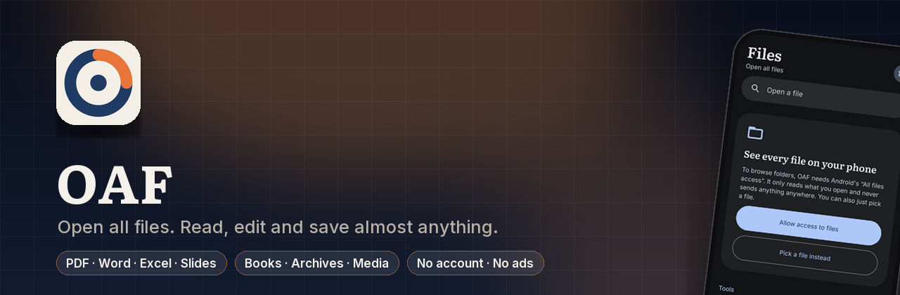
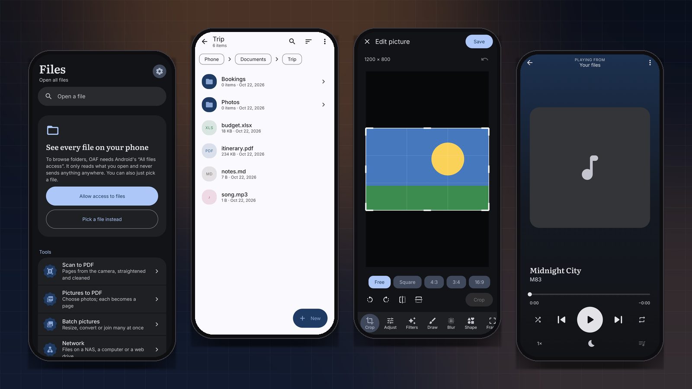
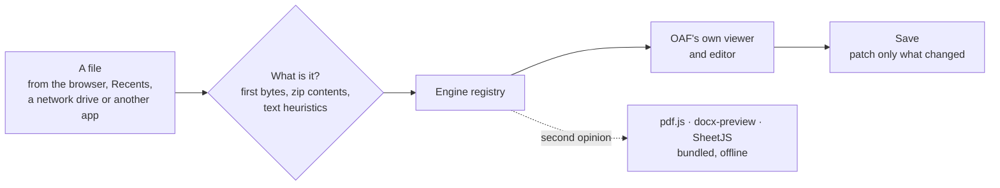
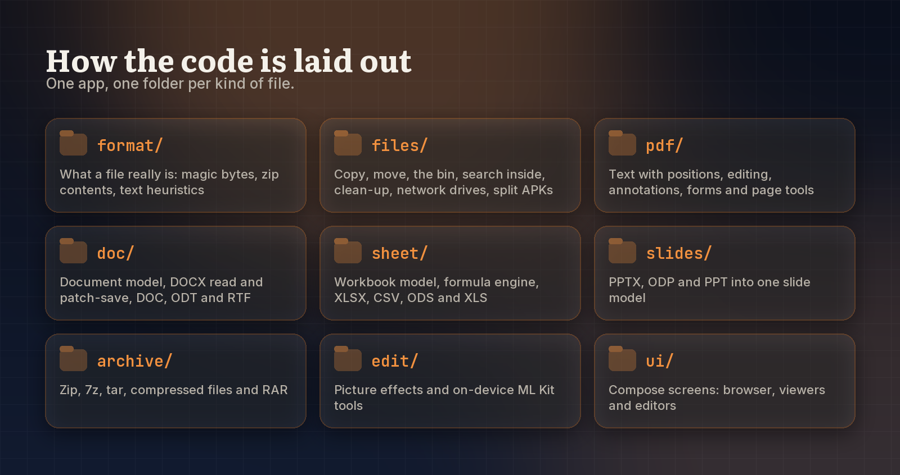

<div align="center">



<br><br>

[](https://developer.android.com)
[](https://kotlinlang.org)
[](https://developer.android.com/compose)
[](LICENSE)
[](https://prempoddar.github.io/OAF/)

**[Website](https://prempoddar.github.io/OAF/)** · **[Download](https://github.com/PremPoddar/OAF/releases)** · **[Privacy](https://prempoddar.github.io/OAF/privacy/)** · **[Report a problem](https://github.com/PremPoddar/OAF/issues)**

</div>

---

**OAF opens almost any file on your phone, and edits most of them.** PDFs, Word and Excel, slides,
books, archives, pictures, music and video, in one quiet, fast app that is reader first: the page is
the interface, and the bars slide away while you read. Open files from its own browser, from Recents,
from a network drive, or from any other app with *Open with*. Nothing is uploaded; it all happens on
the phone.

<p align="center"></p>
<p align="center"><sub>Real screens, drawn by the app's own code.</sub></p>

## ✨ Highlights

<table>
<tr>
<td width="50%" valign="top">

### 📄 PDFs, fully
Search, select, annotate, fill forms and sign. Edit and add text, pictures and shapes. Merge, split,
compress, watermark, rotate and reorder pages, or **scan paper to PDF** with the camera.

</td>
<td width="50%" valign="top">

### 📝 Word &amp; Excel, in place
Styles, lists, tables, find and replace in `.docx`. Formulas, fill down, AutoSum, sorting and sheets in
`.xlsx`. Files are patched, not rewritten, so what OAF doesn't touch survives.

</td>
</tr>
<tr>
<td valign="top">

### 🎬 A proper player
Swipe to seek, brightness and volume; pinch to zoom; subtitles; A-B repeat; frame steps;
screenshots; picture-in-picture; and it resumes where you stopped. Plays links and live streams too.

</td>
<td valign="top">

### 🖼️ Picture editor
Crop, filters, drawing and text, blur and pixelate, shape cut-outs, frames, watermarks,
**remove the background**, **copy text out of a photo**, and batch resize or convert.

</td>
</tr>
<tr>
<td valign="top">

### 🗂️ A real file manager
Search inside documents, a 30-day bin, storage clean-up, Linux file details, and
**network drives** over SMB, SFTP, FTP and WebDAV.

</td>
<td valign="top">

### 📦 Apps, archives &amp; more
Share any installed app, even split ones, as **one installable APK**. Open and make zip, 7z and tar;
read EPUB books, slides, code with highlighting, fonts and app packages.

</td>
</tr>
</table>

OAF also shows up in Android's own file picker, so other apps can pick files through it.

## 📚 What it opens

| | Read | Edit | Saves as |
|---|---|---|---|
| 📄 **PDF** | search, select, contents, links, pinch zoom | annotate, forms, sign, edit text, pictures and shapes, page tools | PDF |
| 📝 **Word** `.docx` | headings, lists, tables, pictures, links, contents | text, styles, tables and rows, find &amp; replace | `.docx`, in place |
| 📝 **Other documents** `.doc` `.odt` `.rtf` | ✓ | ✓ | `.docx` |
| 📊 **Excel** `.xlsx` | formulas, formats, frozen panes, merges | cells, formulas, fill, AutoSum, rows and columns, sort, sheets | `.xlsx`, in place |
| 📊 **Other sheets** `.xls` `.ods` `.csv` `.tsv` | ✓ | ✓ | `.xlsx`; CSV/TSV in place |
| 📽️ **Slides** `.pptx` `.odp` `.ppt` | slides, notes, presenting | — | — |
| 📚 **EPUB** | chapters, contents, text size, remembers your place | — | — |
| 🗜️ **Archives** zip, 7z, tar, gz, bz2, xz, rar | browse, open files inside, passwords | extract; make zip (with a password), 7z, tar | zip, 7z, tar |
| 🖼️ **Pictures** incl. HEIC, AVIF, animated GIF/WebP, SVG | zoom, rotate | crop, filters, draw, blur, shapes, background | JPEG, PNG, WebP |
| 🎧 **Audio &amp; video** | player with metadata, streams | trim, convert, make smaller | — |
| 💻 **Text &amp; code** | highlighting for about 30 languages, Markdown and HTML rendered, JSON/XML tidied | find and replace, undo | same encoding and line endings |
| 📦 **Apps** `.apk` `.apks` `.xapk` `.apkm` | name, version, SDK levels, signer, permissions | install | — |
| 🔤 **Fonts** `.ttf` `.otf` | names, preview, character set | — | — |

Every document can be printed or saved as a PDF through Android's print dialog.

## 🧭 How it works



**It looks at the file, not its name.** Type detection reads the first bytes, peeks inside zips (Word,
Excel and EPUB are zips) and sniffs text, so a misnamed file still opens in the right viewer.

**Engines.** Every format goes through one registry (`engine/Engines.kt`). OAF's own viewers and
editors are the default; bundled web engines (pdf.js, docx-preview, SheetJS) can be switched to for
a second opinion, all offline.

**Saving keeps what OAF doesn't understand.**

- *Word:* each paragraph remembers the XML it came from. Only paragraphs you changed are rebuilt;
  pictures, fields, comments, headers, footers, section settings and formatting OAF doesn't model
  are carried over. New tables and rows get proper XML; undoing after a save never duplicates or
  loses paragraphs.
- *Excel:* cell data, column widths, merges and frozen panes are rewritten in each sheet's XML;
  charts, drawings, defined names, conditional formats and shared strings are kept, and Excel is
  asked to recalculate on open.

**Spreadsheets.** A formula engine with about a hundred functions (maths, statistics, logic, text,
lookups including `XLOOKUP`, dates), cross-sheet references, error values and loop detection.
Inserting or deleting rows rewrites the formulas that point across them, as Excel does.

**PDF.** Pages are drawn by Android's renderer; changes go through PDFBox, each to a new working copy,
so undo steps back through copies. Text is found with its position on the page, so search, selection
and highlights land exactly. Protected PDFs open with their password and are protected again on save.

<details>
<summary><strong>Split apps as one APK</strong></summary>

<br>

Apps from the Play Store often install as a base APK plus "splits" for the screen, processor and
language, which Android's installer can't take as one file. OAF can share them three ways: the
parts bundled as `.apks`, the parts one by one, or, by default, **one universal APK**. For that it
merges the parts with ARSCLib, removes the manifest's split requirements and signs the result with a
key kept in the phone's keystore. It installs anywhere the app isn't already present; because the
signature isn't the developer's, it can't update a copy from a store.

</details>

## 🔐 Privacy

No account, no analytics, no ads. Files are opened and edited on the phone. OAF goes online only to
play a link another app sends it or to reach a network drive you added; server passwords are
encrypted by Android's keystore. The full policy is at
**[prempoddar.github.io/OAF/privacy](https://prempoddar.github.io/OAF/privacy/)**.

## ⚠️ Limits

- Editing is native, not a full office suite: no tracked-changes review, comments, footnotes or
  charts. Tracked changes inside a paragraph you edit are accepted.
- Slides and EPUBs are view-only. `.ppt` shows each slide's text only.
- A drawn signature is a picture on the page, not a cryptographic signature. XFA forms can't be filled.
- RAR5 archives can't be opened.

## 🛠️ Building and testing

Requires JDK 17 or 21 for Gradle.

```bash
./gradlew assembleDebug
./gradlew testDebugUnitTest
```

More than 200 unit tests cover type detection, file operations and the bin, the formula engine
function by function, XLSX and DOCX round trips that save only what changed, the document and sheet
editors, PDF geometry, editing, forms and page tools, archives (including path-traversal attempts),
EPUB, slides, network-drive paths and listings, the picture effects, and joining a real split app
into one APK. `ScreensTest` draws real screens to `app/build/screens`, including the ones above.

## 🗂️ Project layout

<p align="center"></p>

<details>
<summary><strong>As text</strong></summary>

```
format/   file type detection (magic bytes, zip contents, text heuristics)
files/    copy, move, rename, the bin, search inside files, clean-up, network drives, split APKs
text/     encodings, big-file line index, syntax highlighting, JSON/XML tidying
sheet/    workbook model, formula engine, XLSX/CSV/ODS/XLS, the grid editor's model
doc/      document model, DOCX read and patch-save, DOC/ODT/RTF readers, editor with undo
pdf/      geometry, text with positions, editing, annotations, forms, page tools
slides/   PPTX, ODP and PPT into one slide model
book/     EPUB
archive/  zip, 7z, tar, compressed files, RAR
edit/     picture operations and effects, on-device ML Kit tools
pick/     OAF as a file picker for other apps
engine/   which viewer opens which format
ui/       Compose screens: browser, viewers, editors
```

</details>

## 📄 License

[Apache 2.0](LICENSE).

Literata, Inter and JetBrains Mono are used under the SIL Open Font License. Built with Apache POI,
PdfBox-Android, Apache Commons Compress and Net, OkHttp, SMBJ, apksig and ARSCLib (Apache 2.0); JSch
(BSD); AndroidSVG (Apache 2.0); commonmark-java (BSD 2-Clause); XZ for Java (public domain); and junrar,
whose UnRAR licence allows extracting RAR archives but not making a RAR compressor from it.
